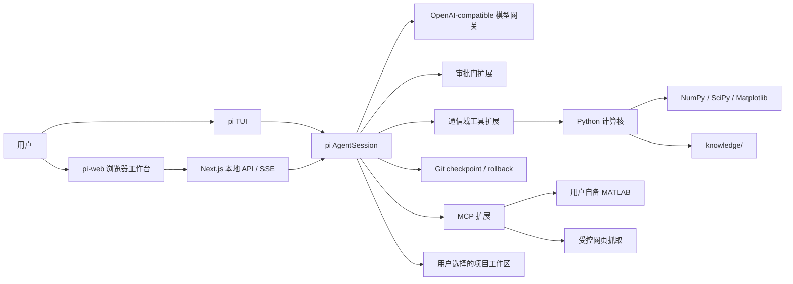

# 通信系统智能体

<div align="center">
  <a href="https://github.com/earendil-works/pi"></a>
  <a href="https://nodejs.org/"></a>
  <a href="https://bun.sh/"></a>
  <a href="https://docs.astral.sh/uv/"></a>
</div>

> [!NOTE]
> 本项目是面向无线通信、协议分析、信号处理、链路预算、性能评估和故障定位的工程智能体。智能体运行在 [pi coding agent](https://github.com/earendil-works/pi) 上，通过 TypeScript 扩展注册通信域工具，并使用 NumPy、SciPy 和 Matplotlib 完成定量计算与绘图。
>
> 浏览器工作台是主要开发入口，在同一会话内完成问答、计算与项目优化；命令行问答和优化脚本作为兼容入口保留。模型负责理解问题和编排流程，公式计算、仿真、协议解析和数值验证优先交给确定性的域工具执行。

> [!CAUTION]
> 优化模式能够执行命令和修改文件。`bash`、`edit`、`write`、`equivalence_check` 以及 MCP 工具在执行前必须经过审批门确认；无交互界面时默认拒绝高风险操作。
>
> API 密钥只能通过环境变量传递。不要提交 `.env`、`agent-home/`、模型凭据、MATLAB 二进制或真实项目数据。

<details>
<summary>目录</summary>

- [特别感谢](#特别感谢)
- [能力与边界](#能力与边界)
- [架构](#架构)
- [域工具](#域工具)
- [环境要求](#环境要求)
- [本地启动](#本地启动)
- [使用方式](#使用方式)
- [Web UI](#web-ui)
- [MATLAB](#matlab)
- [配置说明](#配置说明)
- [开发](#开发)
- [安全说明](#安全说明)
- [已知限制](#已知限制)
- [许可证](#许可证)

</details>

## 特别感谢

- [pi coding agent](https://github.com/earendil-works/pi)：提供智能体会话、工具、扩展、审批 UI 和项目资源加载能力。
- [pi-web](https://github.com/agegr/pi-web)：提供本地浏览器工作台。本项目 vendored 了 `0.7.10` 源码并进行了中文化与界面适配。
- NumPy、SciPy、Matplotlib、CommPy、Reed-Solomon 和 py-polar-codes 等开源项目：提供通信计算与仿真基础。

## 能力与边界

### 通信工程能力

- 自由空间链路预算、路径损耗、EIRP、接收功率和衰落余量。
- 接收链级联噪声系数、热噪声底、灵敏度、载干比和 SINR。
- AWGN、Rayleigh、Rician 信道仿真以及 BER、SNR、容量和频谱效率计算。
- BPSK、QPSK、8PSK、16QAM、64QAM、256QAM 调制、星座、EVM 和链路自适应。
- 卷积码、Hamming、Reed-Solomon、LDPC、Turbo 和 Polar 编译码仿真。
- OFDM、脉冲成形、均衡、扩频、波束成形和同步偏差估计。
- FFT 频谱分析、信号质量诊断、协议帧解析和通信代码体检。
- 星座图、频谱、波形、BER 曲线和眼图 PNG 生成。
- 本地通信知识检索，以及受白名单限制的 RFC、3GPP、arXiv 等在线知识查询。

### 工程护栏

- 通信和信号代码要求明确标注 Hz、dB、dBm、dBi、km、samples/s 等单位。
- 标准数值算法优先使用 NumPy 和 SciPy，不通过手写循环重复实现 FFT、滤波或卷积。
- 协议解析先明确帧结构、字段长度、字节序和校验规则，再执行解析。
- 修改文件前自动记录 Git checkpoint，可通过 `/rollback` 恢复最近一次写入。
- 数值行为改动应使用 `equivalence_check` 对基准实现和候选实现进行可复现比较。
- 工具失败统一返回失败环节、原因和可执行的解决方案。

### 当前不提供

- 不提供无需确认的自动代码修改或任意命令执行。
- 不将 `docs/` 当作通信专业知识库；专业概念优先检索 `knowledge/`。
- 不提供 Octave 作为 MATLAB 的降级实现。
- 不随仓库分发 MATLAB、真实项目、模型密钥或个人会话。
- 不支持任意 URL 在线抓取；`online_knowledge` 只访问固定白名单来源。
- 当前交付形态为 TUI 和本地 Web UI，尚未提供 Tauri 或其他桌面安装包。

## 架构



Pi 负责会话、模型调用和工具编排；`.pi/extensions/comms-tools/` 将工具调用转换为 Python 子进程；`tools/` 负责确定性的通信计算。高风险工具先经过审批门，文件修改前由 checkpoint 扩展记录可恢复状态。

Web UI 使用 vendored Next.js 服务运行。浏览器通过本地 API 和 SSE 驱动与 TUI 相同的 Pi AgentSession，并透传扩展审批请求、工具结果和绘图文件。

主要目录：

| 路径 | 内容 |
| --- | --- |
| `.pi/extensions/` | 域工具注册、审批门和 Git checkpoint 扩展。 |
| `.pi/prompts/` | `/term`、`/fec`、`/diagnose`、`/amc`、`/beamform` 等命令模板。 |
| `.pi/mcp.json` | MATLAB 和受控网页抓取 MCP 配置。 |
| `tools/` | Python 通信计算、仿真、诊断、协议和绘图实现。 |
| `knowledge/` | 通信术语、原理问答、工程评估和故障特征知识。 |
| `config/` | 模型模板以及 QA、Optimize 模式系统提示词。 |
| `scripts/` | 环境装配、启动、自检、路由验证和真实项目验证脚本。 |
| `vendor/pi-web/` | 项目内维护的 pi-web 0.7.10 源码。 |
| `agent-home/` | 项目隔离的模型配置、认证和会话数据，不进入 Git。 |
| `real_projects/` | 真实优化目标，每个项目可维护独立 Git 仓库，不进入 Git。 |

## 域工具

项目通过一个声明式扩展注册 25 个工具：

| 类别 | 工具 |
| --- | --- |
| RF 与链路 | `link_budget`、`path_loss`、`rf_chain`、`interference`、`channel_profile`、`fade_margin` |
| 性能与仿真 | `ber_snr`、`modulation`、`channel`、`channel_coding`、`capacity`、`pulse_shaping`、`ofdm`、`equalizer`、`link_adaptation`、`spread_spectrum`、`beamforming` |
| 信号与协议 | `signal_analysis`、`signal_diagnose`、`sync_estimate`、`frame_parser` |
| 工程护栏 | `comms_lint`、`equivalence_check` |
| 知识与可视化 | `online_knowledge`、`plot` |

定量问题不应由模型口算。例如，链路预算调用 `link_budget`，频率选择性判断调用 `channel_profile`，编码增益调用 `channel_coding`，同步偏差调用 `sync_estimate`。

Web 默认常驻检索、编辑执行基础能力、`link_budget`、`comms_find` 与 `comms_batch`。`comms_find` 根据问题启用少量匹配工具；新的任务恢复精简列表。工具控制器和实验控制器不计入上表的 25 个域工具。

`comms_batch` 支持链路预算 → 干扰/SINR → AWGN 容量的顺序组合，引用前序结果时检查单位。其适用范围为三种固定计算工具，不执行任意代码；将干扰计入噪声后计算容量仍是理论上界。工具出错会停止该链并保留已完成步骤的记录。

## 环境要求

- Git
- Node.js 22 或更高版本
- Bun 1.x
- uv
- Python 3.10 或更高版本，由 uv 创建项目 `.venv`
- Windows 使用 Git Bash 运行 `.sh` 脚本
- 可访问配置的 OpenAI-compatible 模型网关
- MATLAB 可选；只有明确需要 MATLAB 工具箱时才需要安装

项目锁定：

| 组件 | 版本 |
| --- | --- |
| `@earendil-works/pi-coding-agent` | `0.80.6` |
| `@earendil-works/pi-ai` | `0.80.6` |
| `pi-mcp-extension` | `1.5.0` |
| vendored `pi-web` | `0.7.10` |

## 本地启动

### 1. 安装依赖

在项目根目录执行：

```bash
bun install
uv sync
```

`bun install` 安装 Pi 运行时并将 `vendor/pi-web/` 作为 workspace 接入。`uv sync` 根据 `uv.lock` 创建 `.venv`，安装 NumPy、SciPy、Matplotlib、CommPy、Reed-Solomon 和 py-polar-codes 等依赖。

### 2. 配置模型网关

在项目根目录创建 `.env`：

```dotenv
OPENAI_BASE_URL=https://your-gateway.example.com/v1
OPENAI_API_KEY=your-api-key
```

`.env` 已被 Git 忽略。启动脚本只把密钥加载到进程环境中，并根据 `config/models.template.json` 生成 `agent-home/models.json`；生成的模型配置保留环境变量引用，不写入 API Key 明文。

### 3. 运行自检

```bash
scripts/check-runtime.sh --full
```

自检覆盖：

- Git、Node.js、Bun、uv、Pi 和 pi-web。
- 项目虚拟环境和 Pi 隔离目录。
- MATLAB 自动发现和 MCP 配置。
- 域工具与工具白名单的一致性。
- 域工具桥、审批门和回滚扩展冒烟。
- Python 域工具与在线知识测试。

MATLAB 未安装时只报告警告，不影响 Python 域工具和普通问答。

### 4. 选择入口

```bash
scripts/comms-qa.sh
scripts/comms-optimize.sh
scripts/comms-web.sh
```

| 入口 | 用途 | 工具边界 |
| --- | --- | --- |
| `comms-qa.sh` | 通信问答、公式解释、只读分析和绘图。 | 无 `bash`、`edit`、`write`、`equivalence_check` 和 MATLAB。 |
| `comms-optimize.sh` | 真实项目分析、代码修改、验证和等价性检查。 | 执行和写入工具可用，但每次高风险操作需要审批。 |
| `comms-web.sh` | 主要工作台：问答、计算、实验与候选审阅。 | 默认按需发现工具；读、写、执行分级，高风险操作由 Web 待办批准。 |

Web UI 默认地址：

```text
http://127.0.0.1:30190
```

可通过环境变量修改端口：

```bash
COMMS_WEB_PORT=30200 scripts/comms-web.sh
```

Web 工作台不等同于 `comms-qa.sh` 或 `comms-optimize.sh` 的系统提示词入口。需要严格只读边界时，应直接使用 `comms-qa.sh`。

日常使用优先启动 `scripts/comms-web.sh`。工具菜单中的「按需 / 全量 / 关闭」控制当前工具可见性；权限与执行审批仍由服务端检查。

## 使用方式

### 通信问答

```bash
scripts/comms-qa.sh "计算 3.5 GHz、距离 2 km、发射功率 30 dBm 的自由空间链路预算"
```

QA 模式允许读取项目文件、检索 `knowledge/`、调用通信域工具和生成图像，但模型无法获得文件修改或命令执行工具。

常用命令：

| 命令 | 用途 |
| --- | --- |
| `/term` | 检索和解释通信术语。 |
| `/rf-calc` | 编排链路预算、路径损耗和 RF 计算。 |
| `/fec` | 信道编码和编码增益仿真。 |
| `/diagnose` | 信号质量与故障定位。 |
| `/amc` | 链路自适应和 MCS 选择。 |
| `/beamform` | 阵列方向图、MRT 和 ZF 分析。 |
| `/spread` | DSSS、FHSS 和抗干扰分析。 |
| `/report` | 生成结构化通信工程报告。 |

### 真实项目优化

```bash
scripts/comms-optimize.sh
```

当前默认真实项目位于：

```text
real_projects/ModulationPy/
```

该目录是独立 Git 仓库并被根仓库忽略。真实项目优化应遵循：

1. 阅读 `docs/real_project_integration.md` 和 `docs/model_output_review_checklist.md`。
2. 修改前运行 `comms_lint`，识别单位、复现、协议和密钥风险。
3. 先提出改动原因和验证方案，再请求用户审批。
4. 每次写入前由 checkpoint 扩展记录恢复点。
5. 修改后至少运行 `scripts/check-real-project.sh`。
6. 涉及数值行为时使用 `equivalence_check` 提供等价证据。
7. 使用 `/rollback` 回退最近一次文件写入。

除非用户明确要求改变功能，优化应保持计算结果、公开接口和工程行为等价。

## Web UI

`vendor/pi-web/` 对应上游 pi-web `0.7.10`，通过 Bun workspace 软链到 `node_modules/@agegr/pi-web`。项目已完成中文化、布局适配、审批请求透传和绘图文件内联显示。

回复优先展示结论，工具输入、输出和中间过程位于「查看证据」中。运行失败和待批准操作直接显示；并行审批按队列处理，页面刷新后同步服务端待办。会话分叉和历史树沿用 pi-web 的现有功能。

### 通信实验

1. 在会话输入区上方点击「开始实验」，确认项目、目标、允许文件、指标单位、随机种子和最大轮数。验证命令可在高级设置中审阅。
2. 批准创建独立的基线和候选 Git 工作区，再点击「测量基线」。默认 ModulationPy 检查显式传入目标工作区；基准输出调制解调耗时（ms）及归一化/无量纲数值向量。
3. 基线通过后可点击「交给智能体优化」，也可手动修改允许的候选文件后点击「验证当前候选」。命令在创建时冻结；实验期间模型的编辑限于允许文件，执行验证走 `experiment_run`。
4. 每轮记录实际命令、目标目录、种子、文件哈希、日志、指标和数值等价结果。只有通过检查的候选提供「应用快照」；应用前再次审批并检查原项目是否变化。
5. 刷新或重新打开会话可以继续审阅。来源会话的实验在分叉中只读，新建实验后独立修改；停止会取消当前验证和待审批请求，并保留记录，点击「继续实验」后可再运行。应用候选不会自动提交或推送。

实验产物保存在忽略目录 `.comms-experiments/`。完整设计与验收范围见 [Web 改造记录](docs/web_reform.md)。

全新克隆第一次运行 `scripts/comms-web.sh` 时会自动构建 Next.js 生产产物。修改 vendored 源码后，需要删除旧构建产物再启动：

```bash
rm -rf vendor/pi-web/.next
scripts/comms-web.sh
```

前端热更新开发：

```bash
cd vendor/pi-web
bun run dev
```

开发服务器默认监听 `30141`。生产启动脚本默认监听 `30190`，仅绑定 `127.0.0.1`。

升级 pi-web 时不能只修改版本号。需要重新对齐 vendored 源码、本项目中文化改动、RPC 审批链和文件预览行为，然后重新运行完整验证。

## MATLAB

MATLAB 是可选、用户自备的工程工具：

1. `MATLAB_ROOT`
2. 系统 `PATH`
3. Windows 注册表

项目通过 MathWorks MATLAB MCP server 和 `pi-mcp-extension` 注册以下工具：

- `mcp_matlab_check_matlab_code`
- `mcp_matlab_detect_matlab_toolboxes`
- `mcp_matlab_evaluate_matlab_code`
- `mcp_matlab_run_matlab_file`
- `mcp_matlab_run_matlab_test_file`

所有 MATLAB 工具均经过审批门。MATLAB 二进制和安装目录不进入仓库，server 获取方式见 `bin/README.md`。

不提供 Octave 降级路径。普通通信计算应优先使用 Python、NumPy 和 SciPy；只有需要 MATLAB 工具箱或用户明确要求时才调用 MATLAB。

## 配置说明

| 配置 | 用途 |
| --- | --- |
| `.env` | 本机模型网关地址和 API Key，不进入 Git。 |
| `config/models.template.json` | Pi provider 和模型模板。 |
| `agent-home/models.json` | 启动时生成的项目隔离模型配置。 |
| `agent-home/` | Pi 认证、会话和运行数据，不进入 Git。 |
| `.pi/settings.json` | 默认 provider、模型和项目级 Pi package。 |
| `.pi/mcp.json` | MATLAB 与 fetch MCP server 配置。 |
| `scripts/comms-env.sh` | 环境装配和 QA、Optimize 工具白名单。 |

`PI_CODING_AGENT_DIR` 会被设置为项目内 `agent-home/`，避免读取或修改个人 Pi 配置。项目扩展和提示模板从 `.pi/` 加载。

新增域工具或 MCP server 后，必须同步更新 `scripts/comms-env.sh` 的正向白名单。Pi 的 `--tools` 会过滤所有内建、扩展和 MCP 工具；未进入白名单的工具不会出现在对应模式中。

## 开发

常用验证命令：

```bash
scripts/check-runtime.sh --full
scripts/validate-tool-routing.sh
scripts/validate-tool-routing.sh --quick
scripts/check-real-project.sh
bash scripts/check-web-reform.sh
```

分层检查：

```bash
bun scripts/dev/smoke_extension.ts
bun scripts/dev/smoke_gate.ts
bun scripts/dev/smoke_checkpoint.ts
uv run python -X utf8 scripts/tests/test_domain_tools.py
uv run python -X utf8 scripts/tests/test_online_knowledge.py
bunx tsc --noEmit -p vendor/pi-web/tsconfig.json
```

`validate-tool-routing.sh` 会让真实模型逐项调用工具，因此需要有效模型凭据，并可能产生 API 用量。`--quick` 会跳过联网和 MATLAB 场景，但仍不是纯离线检查。

提交前至少运行：

```bash
scripts/check-runtime.sh --full
bunx tsc --noEmit -p vendor/pi-web/tsconfig.json
git diff --check
```

修改 `real_projects/ModulationPy/` 时还必须运行：

```bash
scripts/check-real-project.sh
```

## 安全说明

- 不读取、提交或输出 `.env` 中的模型密钥。
- API Key 只通过环境变量传递，不应写进提示词、代码、日志或测试夹具。
- QA 模式使用正向工具白名单，不依赖提示词约束只读能力。
- 高风险工具在没有交互 UI 时 fail-closed；只有显式设置 `COMMS_APPROVAL=allow-all` 才允许脚本化验收绕过人工确认。
- `equivalence_check` 会执行两条受信命令，只应用于本项目脚本或明确审核过的基准与候选实现。
- MCP 工具统一按 `mcp_` 前缀纳入审批，新增 MCP server 不会自动绕过审批门。
- `online_knowledge` 只访问固定来源，并区分标准、协议正文、知识图谱和论文；论文结论不能直接作为工程标准。
- Web UI 只应绑定本机回环地址，不应未经鉴权直接暴露到局域网或公网。
- `real_projects/` 中的第三方项目应保持独立 Git 历史，不由根仓库提交。

## 已知限制

- Pi 和 pi-web 均处于 pre-1.0 阶段，升级可能改变扩展、工具白名单或 RPC 行为。
- Windows 命令执行依赖 Git Bash；Pi 的 Bash 工具不会自动降级为 PowerShell。
- 首次构建 pi-web 需要额外时间和磁盘空间。
- 部分 FEC、MIMO 和蒙特卡洛仿真计算量较大，应通过 `num_bits`、扫点数和迭代次数控制运行时间。
- MATLAB 能力取决于本机 MATLAB 版本和已安装工具箱。
- 在线知识和模型路由依赖外部网络服务，离线环境只能使用本地知识库和 Python 工具。
- 根仓库当前未提供统一的桌面安装器或自动更新通道。
- 按需发现和实验命令链已用本地测试 provider 验证协议行为；实际网关的模型选择准确率、token 与缓存收益尚未测量。
- 实验等价结论限于已配置的验证命令、输入向量和容差；耗时是本机样本，不代表其它设备性能。
- 当前浏览器工具拒绝窗口缩放，窄屏视觉验收仍待完成；开发环境的 Turbopack 外部包解析异常时可使用 `next dev --webpack`。

## 许可证

根仓库当前未提供统一许可证文件。`vendor/pi-web/` 保留其上游 MIT License，其他第三方依赖分别遵循各自许可证。对外分发或商用前，应补充根项目许可证并完成依赖许可审查。
