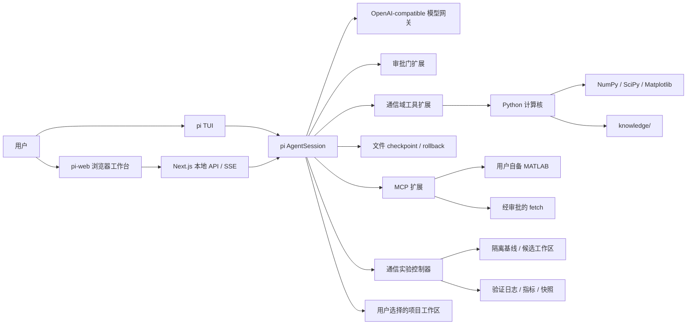

# 通信系统智能体

基于 pi 的通信工程智能体，用确定性工具完成计算、仿真与协议分析，并在本地 Web 工作台中验证和审阅项目优化结果。

<div align="center">
  <a href="https://github.com/earendil-works/pi"></a>
  <a href="https://nodejs.org/"></a>
  <a href="https://bun.sh/"></a>
  <a href="https://docs.astral.sh/uv/"></a>
</div>

面向无线通信、信号处理、链路预算、性能评估和故障定位。模型负责理解任务与选择工具，TypeScript 扩展把工具调用交给 Python 计算核，由 NumPy、SciPy、Matplotlib 等库完成数值计算和绘图。

**主要入口是本地 Web 工作台**：在同一会话中问答、计算、批准操作、测量基线和审阅候选改动。TUI 问答与优化脚本也可独立使用。项目当前交付的是源码和本地运行工具，尚未提供桌面安装包。

> [!CAUTION]
> Web 工作台和 TUI 优化模式能够执行命令、修改文件。写入、绘图、执行验证和 MCP 调用需要审批；无交互界面时默认拒绝这类操作。需要限制代码编辑和命令执行时，请使用 TUI 的 QA 入口。
>
> 模型密钥通过环境变量传递。`.env`、`agent-home/`、实验产物和真实项目目录均不纳入根仓库。

<details>
<summary>目录</summary>

- [特别感谢](#特别感谢)
- [能力与边界](#能力与边界)
- [架构](#架构)
- [域工具](#域工具)
- [环境要求](#环境要求)
- [本地启动](#本地启动)
- [使用方式](#使用方式)
- [Web UI](#web-ui)
- [MATLAB](#matlab)
- [配置说明](#配置说明)
- [开发](#开发)
- [安全说明](#安全说明)
- [已知限制](#已知限制)
- [许可证](#许可证)

</details>

## 特别感谢

- [pi coding agent](https://github.com/earendil-works/pi)：提供智能体会话、工具、扩展、审批 UI 和项目资源加载能力。
- [pi-web](https://github.com/agegr/pi-web)：提供本地浏览器工作台。本仓库保留了 `0.7.10` 的源码副本，并在此基础上进行中文化、审批适配和通信实验功能开发。
- [NumPy](https://numpy.org/)、[SciPy](https://scipy.org/)、[Matplotlib](https://matplotlib.org/)、[CommPy](https://github.com/veeresht/CommPy)、Reed-Solomon 和 py-polar-codes 等项目：提供计算、绘图和信道编码基础。
- [ModulationPy](https://github.com/kirlf/ModulationPy)：提供数字调制项目，用于接入和验证真实优化流程。

## 能力与边界

### 通信工程能力

| 任务 | 可用能力 |
| --- | --- |
| 链路与 RF 评估 | 自由空间链路预算、路径损耗、EIRP、接收功率、衰落余量；级联噪声系数、热噪声底、灵敏度、载干比和 SINR。 |
| 调制与信道仿真 | BPSK、QPSK、8PSK、16/64/256QAM，星座与 EVM；AWGN、Rayleigh、Rician 信道，BER、SNR、容量和频谱效率。 |
| 编码与基带处理 | 卷积码、Hamming、Reed-Solomon、LDPC、Turbo、Polar；OFDM、脉冲成形、均衡、扩频、波束成形和同步偏差估计。 |
| 分析与诊断 | FFT 频谱、信号质量诊断、协议帧解析、通信代码体检。 |
| 知识与绘图 | 本地通信知识检索；白名单来源的在线查询；星座图、频谱、波形、BER 曲线和眼图 PNG。 |
| 项目优化 | 独立基线与候选工作区、冻结验证命令、记录指标与数值等价结果、审阅并应用通过检查的候选快照。 |

计算和仿真结果需要结合输入、单位与模型假设解释。协议解析支持的具体格式和编码仿真的具体码型以工具参数为准。

### 工程护栏

- 通信和信号代码要求标注 Hz、dB、dBm、dBi、km、samples/s 等单位；归一化、线性值和无量纲量也要明确说明。
- 标准数值算法优先使用 NumPy 和 SciPy，不通过手写循环重复实现 FFT、滤波或卷积。
- 协议解析先明确帧结构、字段长度、字节序和校验规则，再执行解析。
- 通过智能体的 `edit` / `write` 修改 Git 仓库中的文件前，checkpoint 扩展记录恢复点；TUI 中可用 `/rollback` 选择记录并恢复对应文件。
- 数值行为改动应使用 `equivalence_check` 比较基准与候选；实验模式通过冻结的命令和容差验证各轮结果。
- 工具失败统一返回失败环节、原因和可执行的解决方案。

### 当前不提供

- 不提供默认免审批的代码修改或命令执行。
- 不将 `docs/` 当作通信专业知识库；专业概念优先检索 `knowledge/`。
- 不提供 Octave 作为 MATLAB 的降级实现。
- 不随仓库分发 MATLAB、真实项目、模型密钥或个人会话；真实项目需另行克隆。
- `online_knowledge` 不接受任意 URL，只查询固定白名单来源；独立的 fetch MCP 调用仍需审批。
- 当前交付形态为 TUI 和本地 Web UI，尚未提供 Tauri 或其他桌面安装包。

## 架构



Pi 负责会话、模型调用和工具编排；[通信工具扩展](.pi/extensions/comms-tools/index.ts) 将工具调用转换为 Python 子进程；[tools/](tools/) 实现通信计算。审批门控制写入和执行，checkpoint 扩展为文件编辑提供恢复记录。

Web UI 使用 Next.js 本地服务，通过 API 和 SSE 驱动与 TUI 相同的 Pi AgentSession。通信实验控制器负责隔离工作区、执行已确认的验证命令，并持久化结果；页面展示审批待办、工具证据和绘图文件。

主要目录：

| 路径 | 内容 |
| --- | --- |
| [.pi/extensions/](.pi/extensions/) | 域工具、审批门、文件 checkpoint 和通信实验控制器。 |
| [.pi/prompts/](.pi/prompts/) | `/term`、`/fec`、`/diagnose`、`/amc`、`/beamform` 等提示模板。 |
| [.pi/mcp.json](.pi/mcp.json) | MATLAB 和 fetch MCP 配置。 |
| [tools/](tools/) | Python 通信计算、仿真、诊断、协议和绘图实现。 |
| [knowledge/](knowledge/) | 通信术语、原理问答、工程评估和故障特征知识。 |
| [config/](config/) | 模型模板以及 QA、Optimize 模式系统提示词。 |
| [docs/](docs/) | 项目接入、产物审阅和开发验收记录。 |
| [scripts/](scripts/) | 环境装配、启动、自检、路由验证和真实项目验证脚本。 |
| [vendor/pi-web/](vendor/pi-web/) | 项目内维护的 pi-web 0.7.10 源码。 |
| [sample_project/](sample_project/) | 最小样例；真实优化目标另行接入。 |
| `agent-home/` | 项目隔离的模型配置、认证和会话数据，不进入 Git。 |
| `real_projects/` | 真实优化目标的独立 Git 仓库，不进入根仓库。 |
| `.comms-experiments/` | 实验状态、日志和工作区等产物，不进入 Git。 |

## 域工具

当前[声明式工具清单](.pi/extensions/comms-tools/defs.ts)包含 25 个通信域工具：

| 类别 | 工具 |
| --- | --- |
| RF 与链路 | `link_budget`、`path_loss`、`rf_chain`、`interference`、`channel_profile`、`fade_margin` |
| 性能与仿真 | `ber_snr`、`modulation`、`channel`、`channel_coding`、`capacity`、`pulse_shaping`、`ofdm`、`equalizer`、`link_adaptation`、`spread_spectrum`、`beamforming` |
| 信号与协议 | `signal_analysis`、`signal_diagnose`、`sync_estimate`、`frame_parser` |
| 工程护栏 | `comms_lint`、`equivalence_check` |
| 知识与可视化 | `online_knowledge`、`plot` |

链路预算调用 `link_budget`，频率选择性判断调用 `channel_profile`，编码增益调用 `channel_coding`，同步偏差调用 `sync_estimate`。定量结论应来自工具输出，并保留输入单位与假设。

Web 默认采用按需发现：常驻文件检索、编辑执行基础工具、`link_budget`、`comms_find` 和 `comms_batch`。其它通信任务先由 `comms_find` 根据关键词启用少量匹配工具，新任务开始时恢复常驻列表。工具菜单也可切换为「全量」或「关闭」；显示策略不替代权限检查。

`comms_batch` 可顺序组合 `link_budget` → `interference` → `capacity`，最多八步，引用前序结构化结果时检查单位。它只支持这三种固定工具；容量步骤支持 AWGN 模式，将干扰计入噪声后的容量仍是理论上界。任一步出错会停止计算链，并保留已完成步骤的记录。

`comms_find`、`comms_batch` 和 `experiment_status` / `experiment_run` / `experiment_note` 属于流程控制工具，不计入上述 25 个域工具。TUI QA 与 Optimize 入口沿用各自的工具白名单。

## 环境要求

| 依赖 | 用途 |
| --- | --- |
| Git | 获取源码、管理真实项目和实验工作区、记录文件快照。 |
| Node.js 22+ | 运行 pi 和 Next.js 服务。 |
| Bun 1.x | 安装 JavaScript 依赖、连接 workspace、运行扩展检查。 |
| uv 与 Python 3.10+ | 根据 `uv.lock` 创建项目 `.venv`，运行 Python 计算核。 |
| OpenAI-compatible 模型网关 | 提供模型推理；需要有效地址、API Key 和可用模型 ID。 |
| MATLAB（可选） | 使用 MATLAB 工具箱时由用户自行安装，普通计算使用 Python。 |

Linux / macOS 在终端运行 `.sh` 脚本；Windows 使用 Git Bash。项目同时处理 POSIX 与 Windows 虚拟环境路径。

项目锁定：

| 组件 | 版本 |
| --- | --- |
| `@earendil-works/pi-coding-agent` | `0.80.6` |
| `@earendil-works/pi-ai` | `0.80.6` |
| `pi-mcp-extension` | `1.5.0`（[vendor 源码](vendor/pi-mcp-extension/)，增加智能体级配置路径） |
| vendored `pi-web` | `0.7.10` |

## 本地启动

### 1. 安装依赖

获取源码并进入项目根目录：

```bash
git clone https://github.com/DemoJustLuGuo/comms_agent_rewrite.git
cd comms_agent_rewrite
```

安装两部分依赖：

```bash
bun install
uv sync
```

`bun install` 安装 pi 运行时，并将 `vendor/pi-web/` 作为 workspace 接入。`uv sync` 根据 `uv.lock` 创建 `.venv`，安装 NumPy、SciPy、Matplotlib、CommPy、Reed-Solomon 和 py-polar-codes 等依赖。无需把本项目安装成 Python 包，也无需全局安装 pi。

### 2. 配置模型网关

在项目根目录自行创建 `.env`，将示例值替换为自己的网关地址和密钥：

```dotenv
OPENAI_BASE_URL="https://your-gateway.example.com/v1"
OPENAI_API_KEY="your-api-key"
```

`.env` 已被 Git 忽略，由启动脚本加载到进程环境中。首次启动根据 [config/models.template.json](config/models.template.json) 生成 `agent-home/models.json`；其中 `apiKey` 保持 `$OPENAI_API_KEY` 引用，不写入密钥明文。

**启动前还要对齐模型 ID**：

1. 在模型模板的 `models[].id` 中填写网关实际支持的 ID。
2. 将 [.pi/settings.json](.pi/settings.json) 的 `defaultModel` 设置为同一个 ID，`defaultProvider` 保持与模板 provider 名称一致。
3. 已启动过的项目还需核对 `agent-home/models.json`：脚本仅在该文件不存在时生成配置，修改模板或网关地址不会自动更新已有文件。保留其它本机设置，只更新需要调整的 provider 字段。

当前模板 ID 为 `qingniao/deepseek-v4.1-flash`，而默认设置为 `deepseek-v4-flash`，两者尚未对齐；模板值也不保证在你的网关可用。Web 中可通过模型配置界面管理模型，TUI 可用 `--model` 临时指定已配置的模型。

### 3. 运行自检

```bash
scripts/check-runtime.sh
scripts/check-runtime.sh --full
```

先运行基础自检；`--full` 额外运行 Python 域工具和在线知识测试。检查范围包括：

- Git、Node.js、Bun、uv、Pi 和 pi-web。
- 项目虚拟环境和 Pi 隔离目录。
- MATLAB 自动发现和 MCP 配置。
- 域工具与工具白名单的一致性。
- 域工具桥、审批门和回滚扩展冒烟。
- Python 域工具与在线知识测试（`--full`）。

MATLAB 未安装时只报告警告，不影响 Python 域工具和普通问答。自检检查本机运行条件，不代表已验证网关鉴权、模型可用性或真实模型的工具选择效果。

### 4. 选择入口

日常使用启动 Web 工作台：

```bash
scripts/comms-web.sh
```

| 入口 | 用途 | 工具边界 |
| --- | --- | --- |
| `scripts/comms-qa.sh` | TUI 通信问答、公式解释、文件分析和绘图。 | 无 `bash`、`edit`、`write`、`equivalence_check` 和 MATLAB；绘图、fetch MCP 仍需审批。 |
| `scripts/comms-optimize.sh` | TUI 项目分析、代码修改、验证和等价性检查。 | 写入与执行需要逐次审批，MATLAB 按需启动。 |
| `scripts/comms-web.sh` | 主要工作台：问答、计算、实验与候选审阅。 | 默认按需发现工具，写入与执行在页面待办中批准。 |

Web UI 默认地址：

```text
http://127.0.0.1:30190
```

可通过环境变量修改端口：

```bash
COMMS_WEB_PORT=30200 scripts/comms-web.sh
```

Web 与 TUI 模式共享扩展，但不会自动附加 QA / Optimize 脚本的模式提示词。Web 的「按需」是工具显示策略，仍包含编辑和执行能力；需要禁用代码编辑和命令执行时，使用 `scripts/comms-qa.sh`。

打开页面后，在侧栏「选择项目…」→「自定义路径…」中填入任意工作目录，再点击「新建」开始会话。通信域工具、提示词模板与 `AGENTS.md` 按智能体仓库根加载（`vendor/pi-web/lib/agent-resources.ts`），不随所选目录变化；只有「按需发现」策略与实验功能依赖工具集合，与目录无关。要在智能体仓库自身代码上工作时再选择本仓库根目录。

首次启动 Web 会自动构建生产产物，详见 [Web UI](#web-ui)。TUI 入口可直接运行，也可在脚本后传入初始问题或任务。

## 使用方式

### 通信问答

```bash
scripts/comms-qa.sh "计算 3.5 GHz、距离 2 km、发射功率 30 dBm 的自由空间链路预算"
```

QA 模式允许读取项目文件、检索 `knowledge/`、调用通信域工具；生成图像需要批准写入。以下问题也可以直接输入 Web 会话：

```text
比较 BPSK 与 QPSK 在 AWGN 下的理论 BER，Eb/N0 从 0 到 12 dB，说明假设并绘图。
分析接收链的级联噪声系数：两级增益分别为 20 dB、10 dB，噪声系数为 2 dB、5 dB。
解释 OFDM 循环前缀的作用，区分物理单位与归一化仿真参数。
```

数值任务应出现对应工具调用，输入、输出与单位可在证据中查看；缺少必要参数时先补充信息。

常用命令：

| 命令 | 用途 |
| --- | --- |
| `/term` | 检索和解释通信术语。 |
| `/rf-calc` | 编排链路预算、路径损耗和 RF 计算。 |
| `/capacity` | 信道容量和频谱效率分析。 |
| `/fec` | 信道编码和编码增益仿真。 |
| `/diagnose` | 信号质量与故障定位。 |
| `/amc` | 链路自适应和 MCS 选择。 |
| `/beamform` | 阵列方向图、MRT 和 ZF 分析。 |
| `/spread` | DSSS、FHSS 和抗干扰分析。 |
| `/ofdm`、`/pulse` | OFDM 与脉冲成形分析。 |
| `/frame`、`/lint` | 协议帧解析和通信代码体检。 |
| `/equiv`、`/optimize-loop` | 等价校验与人工审批优化闭环，需使用允许执行的入口。 |
| `/report` | 生成结构化通信工程报告。 |

这些命令来自 [.pi/prompts/](.pi/prompts/) 的提示模板，用于组织任务；模板不会赋予当前入口白名单之外的工具权限。

### 真实项目优化

当前接入对象为 [ModulationPy](https://github.com/kirlf/ModulationPy)，提供 PSK / QAM 调制解调。它位于 `real_projects/ModulationPy/`，拥有独立 Git 历史，并被根仓库忽略。全新克隆本项目后，需要单独获取：

```bash
mkdir -p real_projects
git clone https://github.com/kirlf/ModulationPy.git real_projects/ModulationPy
scripts/check-real-project.sh
scripts/comms-optimize.sh
```

已有目标目录时保留其版本和修改，不重复克隆或覆盖。接入范围与验证要求以 [真实项目接入记录](docs/real_project_integration.md) 和 [模型产物审阅清单](docs/model_output_review_checklist.md) 为准；当前可用验证入口是 `.sh` 脚本。

TUI 优化的基本流程：

1. 阅读上述文档，确认目标、允许文件和需要保持的行为。
2. 修改前运行 `comms_lint`，识别单位、复现、协议和密钥风险。
3. 说明改动原因与验证方案，通过审批门批准本次写入或执行。
4. 每次写入前由 checkpoint 扩展记录恢复点。
5. 修改后至少运行 `scripts/check-real-project.sh`。
6. 涉及数值行为时使用 `equivalence_check` 提供等价证据。
7. 审阅目标仓库的 diff；需要回退时，用 `/rollback` 选择本会话对应的文件恢复点。

除非用户明确要求改变功能，优化应保持计算结果、公开接口和工程行为等价。回环测试只覆盖其输入范围，涉及 BER、噪声或软判决时还需相应数值检查。Web 中的隔离实验流程见下节。

## Web UI

[vendor/pi-web/](vendor/pi-web/) 基于上游 pi-web `0.7.10`，通过 Bun workspace 接入。工作台支持中文界面、会话历史与分叉、模型配置、文件浏览、绘图文件内联显示，以及通信工具和实验审阅。

回复优先显示结论，工具参数、输出和中间过程放在「查看证据」中。运行失败和待批准操作直接显示；多个审批按队列处理，刷新后重新同步服务端待办。收到审批时可以查看操作摘要，再批准或拒绝。

### 通信实验

1. **确认范围**：在输入区上方点击「开始实验」，填写项目、目标、允许修改的文件、随机种子和最大轮数。高级设置可审阅验证命令、基准命令和指标单位。
2. **测量基线**：批准创建独立的基线与候选 Git 工作区，再点击「测量基线」。默认 ModulationPy 检查显式传入实验工作区；基准输出调制解调耗时（ms）和归一化 / 无量纲数值向量。
3. **修改并验证**：基线通过后点击「交给智能体优化」，或手动修改允许的候选文件后点击「验证当前候选」。命令、种子、容差和预算在创建时冻结；模型只能编辑候选允许文件，验证通过 `experiment_run` 执行。
4. **审阅候选**：每轮保留命令、目标目录、种子、文件哈希、日志、指标和数值等价结果。只有通过检查的候选显示「应用快照」；应用前再次审批，并检查原项目是否已变化。
5. **恢复或停止**：刷新或重新打开会话可继续审阅。分叉会话对来源实验只读，可以新建自己的实验。「停止实验」取消当前验证和待审批请求并保留记录，点击「继续实验」后才能再运行。

**应用快照会写回原项目，但不会自动提交或推送。** 实验产物保存在忽略目录 `.comms-experiments/`；完整设计、历史测量口径与验收范围见 [Web 改造记录](docs/web_reform.md)。

### 构建与热更新

全新克隆第一次运行 `scripts/comms-web.sh` 时会自动构建 Next.js 生产产物。启动脚本根据 `.next/BUILD_ID` 判断是否已有构建，不会自动检测源码变化。修改 Web 源码后，先重新构建再启动：

```bash
cd vendor/pi-web
bunx next build
cd ../..
scripts/comms-web.sh
```

也可删除旧的 `vendor/pi-web/.next/` 构建产物后让启动脚本重建。只删除生成目录，保留源码、配置和会话。

前端开发使用热更新。先在项目根目录进入 Bash 并加载启动环境，再进入 Web 源码目录：

```bash
bash
source scripts/comms-env.sh
cd vendor/pi-web
bun run dev
```

开发服务器默认使用 `30141`，生产入口默认使用 `30190` 并绑定 `127.0.0.1`。环境装配使开发进程继承项目模型配置和隔离目录；浏览器中新建会话仍需选择本仓库根目录。单独运行 `bun run dev` 不会自动加载这套环境。

如果开发环境出现 Turbopack 外部包解析错误，可在同一 Web 源码目录改用 webpack，并显式绑定回环地址：

```bash
bunx next dev --webpack -p 30141 --hostname 127.0.0.1
```

升级 pi-web 时需要同时对齐上游源码、本项目中文化改动、RPC 审批链、文件预览和实验功能，再运行相应验证；只改版本号不足以完成升级。

## MATLAB

MATLAB 是可选、用户自备的工程工具。安装位置按以下顺序自动发现：

1. `MATLAB_ROOT`
2. 系统 `PATH`
3. Windows 注册表

安装 MATLAB 并准备 MathWorks MATLAB MCP server 后，项目通过 `pi-mcp-extension` 注册以下工具：

- `mcp_matlab_check_matlab_code`
- `mcp_matlab_detect_matlab_toolboxes`
- `mcp_matlab_evaluate_matlab_code`
- `mcp_matlab_run_matlab_file`
- `mcp_matlab_run_matlab_test_file`

MATLAB MCP 使用 `lazy` 生命周期，会话启动时不连接 MATLAB。需要 MATLAB 时，在优化模式会话中输入 `/mcp:start matlab`；连接成功后才注册上述工具。可用 `/mcp matlab` 查看状态，用 `/mcp:stop matlab` 停止服务。当前插件的懒加载由该启动命令触发；QA 模式仍不允许调用 MATLAB 工具。

所有 MATLAB 工具均经过审批门。server 获取方式见 [bin/README.md](bin/README.md)，MATLAB 二进制和安装目录不进入仓库。未安装 MATLAB 或缺少 server 时，相关能力不可用，其它 Python 工具仍可使用。

不提供 Octave 降级路径。普通通信计算应优先使用 Python、NumPy 和 SciPy；只有需要 MATLAB 工具箱或用户明确要求时才调用 MATLAB。

## 配置说明

| 配置 | 用途 |
| --- | --- |
| `.env` | 本机模型网关地址和 API Key，不进入 Git。 |
| [config/models.template.json](config/models.template.json) | 首次生成配置时使用的 provider 和模型模板。 |
| `agent-home/models.json` | 启动时生成的项目隔离模型配置。 |
| `agent-home/` | Pi 认证、会话和运行数据，不进入 Git。 |
| [.pi/settings.json](.pi/settings.json) | 默认 provider、模型；项目级 `extensions` 指向 vendor 的 MCP 扩展（TUI 入口用）。 |
| [.pi/mcp.json](.pi/mcp.json) | MATLAB 与 fetch MCP server 配置，当前分别为 `lazy` 和 `eager`。 |
| [scripts/comms-env.sh](scripts/comms-env.sh) | 环境装配和 QA、Optimize 工具白名单；导出 `COMMS_AGENT_ROOT`。 |
| [vendor/pi-web/lib/agent-resources.ts](vendor/pi-web/lib/agent-resources.ts) | 把扩展、提示词和 `AGENTS.md` 锚定到智能体仓库根，与 Web 工作目录无关。 |
| [.pi/extensions/comms-tools/catalog.ts](.pi/extensions/comms-tools/catalog.ts) | Web 常驻工具集合与按需发现规则。 |

通过启动脚本运行时，`PI_CODING_AGENT_DIR` 指向项目内 `agent-home/`，配置、认证和会话与个人 pi 目录隔离；`PYTHON_BIN` 指向项目 `.venv`；`COMMS_AGENT_ROOT` 指向仓库根，供 Web 资源注入与 `vendor/pi-mcp-extension` 的配置解析使用。TUI 入口从 `<cwd>/.pi/` 加载扩展（因此需在仓库根运行），Web 入口则始终加载智能体仓库根的那一份——两种入口都只注册一次，路径按 realpath 去重。直接运行全局 `pi` 或独立的开发服务器，不会自动获得这套启动环境。

新增域工具或 MCP server 后，必须同步更新 TUI 入口的正向白名单。Pi 的 `--tools` 会过滤内建、扩展和 MCP 工具；未进入白名单的工具不会出现在对应模式中。Web 按需发现只在可用工具中选择，不会突破工具权限边界。

## 开发

开发时按修改范围选择检查：

| 命令 | 验证范围 |
| --- | --- |
| `scripts/check-runtime.sh` | 运行依赖、白名单守卫、域工具桥、审批与文件回滚冒烟。 |
| `scripts/check-runtime.sh --full` | 基础自检，加 Python 域工具与在线知识测试。 |
| `bash scripts/check-web-reform.sh` | 工具发现、隔离实验、实验命令与 Web 操作、本地测试 provider 协议链、类型和消息测试。 |
| `scripts/check-real-project.sh` | 默认 ModulationPy 目标的调制解调测试。 |
| `scripts/validate-tool-routing.sh` | 真实模型的工具调用与结果输出验证。 |
| `scripts/validate-tool-routing.sh --quick` | 同上，跳过在线知识与 MATLAB 场景。 |

分层检查：

```bash
bun scripts/dev/smoke_extension.ts
bun scripts/dev/smoke_gate.ts
bun scripts/dev/smoke_checkpoint.ts
uv run python -X utf8 scripts/tests/test_domain_tools.py
uv run python -X utf8 scripts/tests/test_online_knowledge.py
bunx tsc --noEmit -p vendor/pi-web/tsconfig.json
```

`validate-tool-routing.sh` 会让真实模型逐项调用工具，需要有效模型凭据并产生 API 用量；`--quick` 仍会访问模型网关。该脚本显式设置 `COMMS_APPROVAL=allow-all`，用于已审阅的无头验收，不适合作为日常交互启动方式。Web 改造检查中的本地测试 provider 用于验证协议行为，不能证明实际模型会稳定选择正确工具。

提交前至少运行：

```bash
scripts/check-runtime.sh --full
bunx tsc --noEmit -p vendor/pi-web/tsconfig.json
git diff --check
```

修改 `real_projects/ModulationPy/` 时还必须运行并审阅：

```bash
scripts/check-real-project.sh
git -C real_projects/ModulationPy diff
```

数值行为改动还需提供等价证据。详细范围见 [真实项目接入记录](docs/real_project_integration.md)，新增代码应遵循 [AGENTS.md](AGENTS.md) 的单位、算法与审批要求。

## 安全说明

- 智能体不应读取、提交或输出 `.env` 中的模型密钥；启动脚本负责加载环境。
- API Key 只通过环境变量传递，不应写进提示词、代码、日志或测试夹具。
- QA 的代码只读边界由正向工具白名单实现；绘图属于写入，fetch MCP 属于执行，仍经过审批。
- 写入与执行工具在没有交互 UI 时默认拒绝（fail-closed）。`COMMS_APPROVAL=allow-all` 仅供明确授权的无头验收，不作为日常默认配置。
- `equivalence_check` 会执行两条受信命令，只应用于本项目脚本或明确审核过的基准与候选实现。
- MCP 工具统一按 `mcp_` 前缀纳入审批，新增 MCP server 不会自动绕过审批门。
- `online_knowledge` 只访问固定来源，并区分标准、协议正文、知识图谱和论文；论文结论不能直接作为工程标准。
- Web 生产入口绑定本机回环地址；不要把未经鉴权的服务直接暴露到局域网或公网。
- `real_projects/` 中的第三方项目保留独立 Git 历史。应用候选、提交、推送和发布分别授权。
- 文件 checkpoint 只覆盖本会话经 `edit` / `write` 记录的文件改动，不覆盖任意 shell 命令、外部程序或整仓数据。回退时选中对应文件记录。

## 已知限制

- Pi 和 pi-web 均处于 pre-1.0 阶段，升级可能改变扩展、工具白名单或 RPC 行为。
- Windows 命令执行依赖 Git Bash；Pi 的 Bash 工具不会自动降级为 PowerShell。
- 首次构建 pi-web 需要额外时间和磁盘空间。
- 部分 FEC、MIMO 和蒙特卡洛仿真计算量较大，应通过 `num_bits`、扫点数和迭代次数控制运行时间。
- MATLAB 能力取决于本机 MATLAB 版本和已安装工具箱。
- 在线知识和模型推理依赖外部服务。离线时可直接读取本地知识、运行 Python 工具和测试，模型会话仍需要可访问的模型服务。
- 根仓库当前未提供统一的桌面安装器或自动更新通道。
- 按需发现和实验命令链已有本地测试 provider 的协议验证；实际网关的工具选择准确率、token 与缓存收益尚未测量，真实模型持续优化行为尚未验收。
- 实验等价结论限于已配置的验证命令、输入向量和容差；耗时是本机样本，不代表其它设备性能。
- 窄屏视觉验收尚未完成。开发环境遇到 Turbopack 外部包解析异常时，可使用前述 webpack 开发命令。
- 当前默认模型设置与模板 ID 尚未对齐；已有 `agent-home/models.json` 也不会随模板自动更新，启动前按 [模型网关配置](#2-配置模型网关) 核对。

## 许可证

根仓库尚未提供统一许可证文件，根项目的授权条款待确定；不能从某个依赖的许可证推导根项目许可。

[vendor/pi-web/LICENSE](vendor/pi-web/LICENSE) 保留上游 MIT License。另行接入的 ModulationPy 使用 BSD-3-Clause，其它第三方依赖分别遵循各自许可证。对外分发或商用前，应确定根项目许可证并核对依赖许可。
